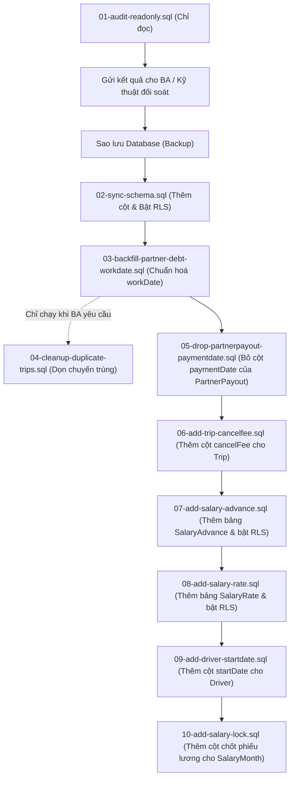

# Hướng Dẫn Chạy Script SQL Trên Supabase Production

Thư mục này chứa các script SQL an toàn dùng để kiểm tra, đồng bộ schema và chuẩn hoá dữ liệu trên cơ sở dữ liệu Supabase Production (Cloud).

> [!CAUTION]
> **CẢNH BÁO QUAN TRỌNG:**
> 1. Mọi script trong thư mục này **DO USER TRỰC TIẾP CHẠY TAY** trên **Supabase SQL Editor** của đúng dự án Production.
> 2. Dev và hệ thống tự động tuyệt đối không kết nối hay can thiệp trực tiếp lên database Production.
> 3. **Tuyệt đối không chạy** `npm run db:setup` hoặc `npm run db:push` lên database Production (sẽ ghi đè dữ liệu hoặc chạy seed mẫu).

---

## 1. Thứ Tự Thực Hiện



### Bước 1: Khảo sát hiện trạng (`01-audit-readonly.sql`)
- **Khuyến nghị**: Nên chạy thử `01-audit-readonly.sql` trên **Supabase Studio local** (cổng Studio trên máy của anh) trước khi chạy trên Production để chắc chắn các câu lệnh không bị lỗi cú pháp.
- Mở Supabase SQL Editor trên Production, dán nội dung file `01-audit-readonly.sql`.
- **Lưu ý cách chạy**: Supabase SQL Editor chỉ hiển thị kết quả của câu lệnh cuối cùng nếu bấm Run cả file. Vì vậy hãy **chạy từng khối**:
  1. Bôi đen (highlight) một khối đánh số bắt đầu từ dòng `-- >>> KHỐI ...` đến hết dấu chấm phẩy (`;`).
  2. Bấm nút **Run selected** (hoặc nhấn tổ hợp phím **Ctrl + Enter** / **Cmd + Enter**).
  3. Sao chép kết quả từng khối gửi cho BA để đối chiếu hiện trạng schema và dữ liệu.

### Bước 2: Sao lưu Database (Backup)
Bắt buộc thực hiện sao lưu trước khi chạy bất kỳ script chỉnh sửa nào (xem mục 2 bên dưới).

### Bước 3: Đồng bộ Schema & Bật RLS (`02-sync-schema.sql`)
- Chạy `-- >>> KHỐI 01` (chứa transaction `BEGIN; ... COMMIT;`) để bổ sung cột `endDate` cho `Driver` và `OfficeStaff` (nếu thiếu) và kích hoạt Row Level Security (RLS) cho cả 9 bảng.
- Bôi đen chạy lần lượt `-- >>> KHỐI 02` và `-- >>> KHỐI 03` để kiểm tra lại kết quả.

### Bước 4: Chuẩn hoá workDate cho PartnerDebt (`03-backfill-partner-debt-workdate.sql`)
- Bôi đen chạy câu lệnh ở `BƯỚC 1` (chỉ SELECT) để xem trước các dòng lệch ngày.
- Khi đã kiểm tra và backup xong: xoá cặp ký tự `/*` và `*/` bao quanh `BƯỚC 2 & 3`, bôi đen khối này và bấm **Run selected** để thực hiện cập nhật trong transaction an toàn.

### Bước 5: Dọn dẹp chuyến trùng (`04-cleanup-duplicate-trips.sql`)
- **Chỉ thực hiện khi BA xác nhận** cần dọn dẹp các bản ghi bị double-submit.
- Mặc định khối lệnh xoá ở `BƯỚC 2` đã được đóng comment `/* ... */`. Chỉ mở ra chạy sau khi đã xem xét kỹ kết quả ở `BƯỚC 1`.

### Bước 6: Bỏ cột `paymentDate` của `PartnerPayout` (`05-drop-partnerpayout-paymentdate.sql`)
- **Chạy SAU khi code mới đã deploy** (code mới không còn đọc/ghi cột này).
- Chạy an toàn (`DROP COLUMN IF EXISTS`), có thể chạy lại nếu cần.

### Bước 7: Thêm cột `cancelFee` cho `Trip` (`06-add-trip-cancelfee.sql`)
- **Chạy SAU khi code mới đã deploy** (hủy chuyến có phí hủy).
- Chạy an toàn (`ADD COLUMN IF NOT EXISTS`), có thể chạy lại nếu cần.

### Bước 8: Thêm bảng `SalaryAdvance` (`07-add-salary-advance.sql`)
- **Chạy SAU khi code mới đã deploy** (tạm ứng lương riêng).
- Tạo bảng `SalaryAdvance`, 2 index và bật RLS (`ENABLE ROW LEVEL SECURITY`). Có thể chạy lại lại an toàn.

### Bước 9: Thêm bảng `SalaryRate` (`08-add-salary-rate.sql`)
- **Chạy SAU khi code mới đã deploy** (mức lương cơ bản có ngày hiệu lực).
- Tạo bảng `SalaryRate`, index và bật RLS (`ENABLE ROW LEVEL SECURITY`). Có thể chạy lại an toàn.

### Bước 10: Thêm cột `startDate` cho `Driver` (`09-add-driver-startdate.sql`)
- **Chạy SAU khi code mới đã deploy** (tính lương theo ngày công).
- Chạy an toàn (`ADD COLUMN IF NOT EXISTS`), có thể chạy lại nếu cần.

### Bước 11: Thêm cột chốt phiếu lương cho `SalaryMonth` (`10-add-salary-lock.sql`)
- **Chạy SAU khi code mới đã deploy** (chốt phiếu lương / mở chốt).
- Chạy an toàn (`ADD COLUMN IF NOT EXISTS`), có thể chạy lại nếu cần.

---

## 2. Hướng Dẫn Sao Lưu Database (Backup)

Trước khi chạy script 02 hoặc 03, hãy thực hiện một trong hai cách sau:
- **Cách 1 (Khuyên dùng - Trên Dashboard Supabase):**
  Vào Dashboard dự án Supabase → chọn mục **Database** ở thanh bên trái → chọn tab **Backups** → bấm **Take Backup** (nếu gói dịch vụ hỗ trợ sao lưu tức thời).
- **Cách 2 (Qua dòng lệnh pg_dump):**
  Chạy lệnh xuất dữ liệu ra file sao lưu:
  ```bash
  pg_dump -d "<SUPABASE_DB_URL_CONNECTION_STRING>" -F c -b -v -f "carms_backup_$(date +%Y%m%d_%H%M%S).dump"
  ```

---

## 3. Xử Lý Sự Cố: Nếu Sau Khi Chạy `02` Ứng Dụng Báo Lỗi Đọc/Ghi

- Ứng dụng CarMS truy vấn database qua Prisma bằng connection string với vai trò chủ sở hữu bảng (`postgres`), mặc định bỏ qua RLS nên việc bật RLS không làm ảnh hưởng đến ứng dụng.
- Nếu sau khi chạy `02-sync-schema.sql` phát sinh lỗi đọc/ghi ở các màn hình tài chính, có thể hoàn tác riêng cho 2 bảng mới bằng lệnh:
  ```sql
  ALTER TABLE "OtherExpense" DISABLE ROW LEVEL SECURITY;
  ALTER TABLE "PartnerDebt" DISABLE ROW LEVEL SECURITY;
  ```
- Sau đó thông báo ngay cho BA (tuyệt đối không tự ý tắt RLS ở 7 bảng còn lại).
